<p align="center">
  <a href="https://afterglow-site-ashy.vercel.app">
    <picture>
      <source srcset="assets/hero.webp" type="image/webp">
      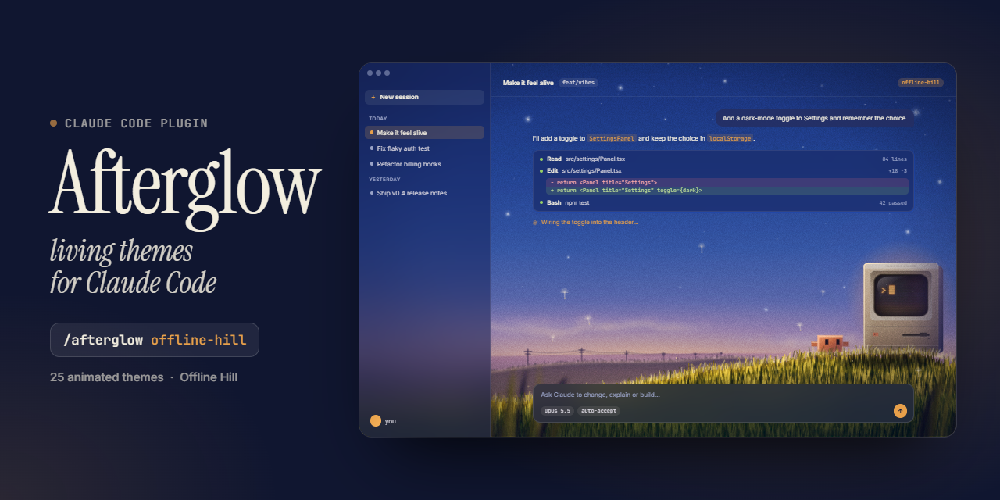
    </picture>
  </a>
</p>

<h1 align="center">Afterglow</h1>

<p align="center">
  <b>Living backdrops for Claude Code on desktop.</b><br>
  25 animated themes that repaint the whole app, frost its panels like glass
  and play a hand-built scene behind the chat.
</p>

<p align="center">
  
  
  
  
</p>

<p align="center">
  <a href="https://afterglow-site-ashy.vercel.app"><b>Try them live →</b></a>
  &nbsp;·&nbsp; <a href="#install">Install</a>
  &nbsp;·&nbsp; <a href="#gallery">Gallery</a>
</p>

Every scene is a single SVG animated by its own CSS: no scripts, and it rests in a composed still picture
when your system asks for reduced motion.

## Install

**In a Claude Code terminal session**, at the prompt:

```
/plugin install afterglow --marketplace 0xCodez/afterglow
```

Answer `y` to add the marketplace, then pick a scope (user scope makes it available in every session).

**From a shell:**

```
claude plugin install afterglow --marketplace 0xCodez/afterglow
```

**In the desktop app**, where `/plugin` does not run: click **+** next to the prompt box, then **Plugins**,
**Add marketplace** with `0xCodez/afterglow`, then **Add plugin**.

Then put one on:

```
/afterglow cloud-nine
```

## Gallery

25 built in. Click a preview to watch it
move.

<table>
  <tr>
    <td width="33%" align="center" valign="top">
      <a href="https://afterglow-site-ashy.vercel.app/t/ascii-atlas">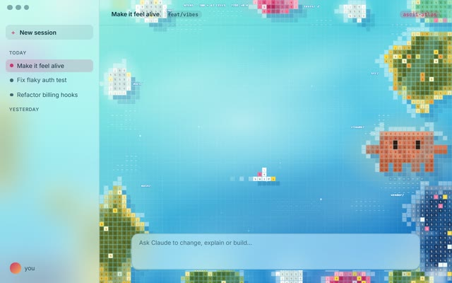</a><br>
      <b>ASCII Atlas</b> · light<br>
      <code>/afterglow ascii-atlas</code>
    </td>
    <td width="33%" align="center" valign="top">
      <a href="https://afterglow-site-ashy.vercel.app/t/cypress-hill">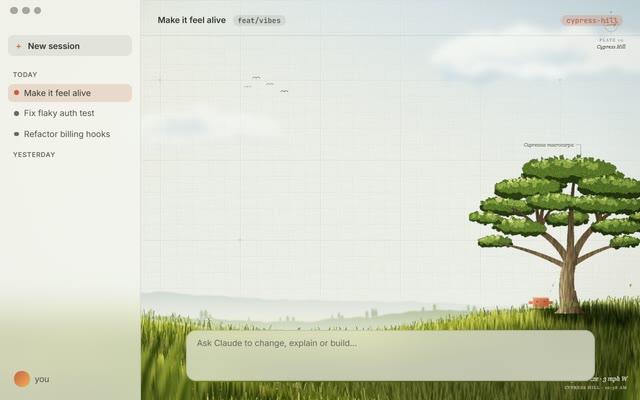</a><br>
      <b>Cypress Hill</b> · light<br>
      <code>/afterglow cypress-hill</code>
    </td>
    <td width="33%" align="center" valign="top">
      <a href="https://afterglow-site-ashy.vercel.app/t/sticker-bomb">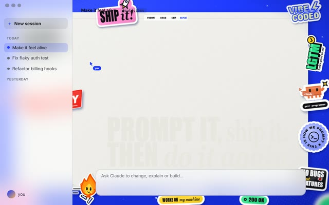</a><br>
      <b>Sticker Bomb</b> · light<br>
      <code>/afterglow sticker-bomb</code>
    </td>
  </tr>
  <tr>
    <td width="33%" align="center" valign="top">
      <a href="https://afterglow-site-ashy.vercel.app/t/paper-trail">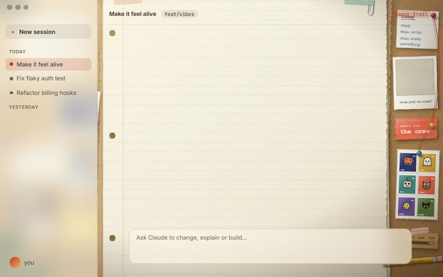</a><br>
      <b>Paper Trail</b> · light<br>
      <code>/afterglow paper-trail</code>
    </td>
    <td width="33%" align="center" valign="top">
      <a href="https://afterglow-site-ashy.vercel.app/t/spec-sheet">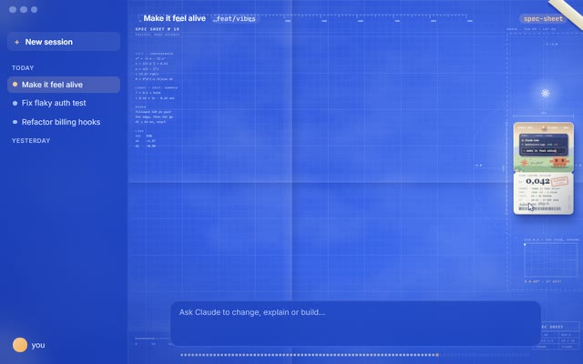</a><br>
      <b>Spec Sheet</b> · dark<br>
      <code>/afterglow spec-sheet</code>
    </td>
    <td width="33%" align="center" valign="top">
      <a href="https://afterglow-site-ashy.vercel.app/t/sticker-notebook">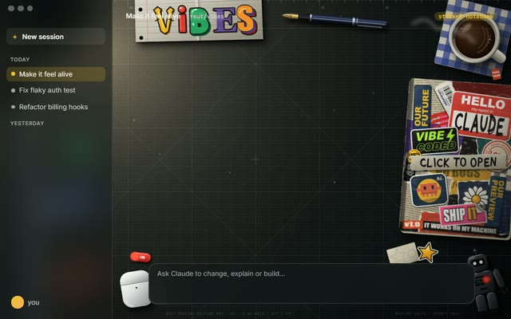</a><br>
      <b>Sticker Notebook</b> · dark<br>
      <code>/afterglow sticker-notebook</code>
    </td>
  </tr>
  <tr>
    <td width="33%" align="center" valign="top">
      <a href="https://afterglow-site-ashy.vercel.app/t/puppet-strings">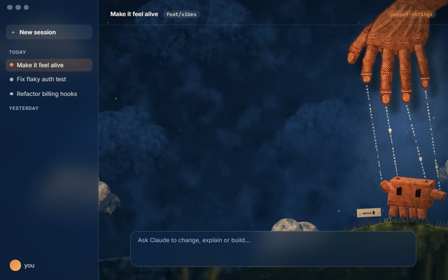</a><br>
      <b>Puppet Strings</b> · dark<br>
      <code>/afterglow puppet-strings</code>
    </td>
    <td width="33%" align="center" valign="top">
      <a href="https://afterglow-site-ashy.vercel.app/t/green-light">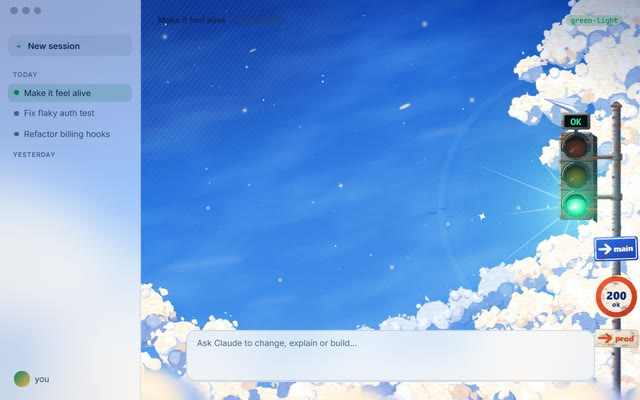</a><br>
      <b>Green Light</b> · light<br>
      <code>/afterglow green-light</code>
    </td>
    <td width="33%" align="center" valign="top">
      <a href="https://afterglow-site-ashy.vercel.app/t/heat-map">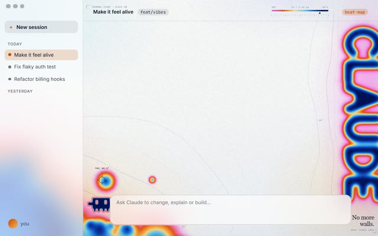</a><br>
      <b>Heat Map</b> · light<br>
      <code>/afterglow heat-map</code>
    </td>
  </tr>
  <tr>
    <td width="33%" align="center" valign="top">
      <a href="https://afterglow-site-ashy.vercel.app/t/record-shop">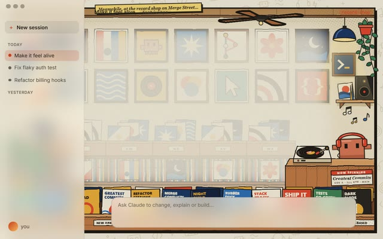</a><br>
      <b>Record Shop</b> · light<br>
      <code>/afterglow record-shop</code>
    </td>
    <td width="33%" align="center" valign="top">
      <a href="https://afterglow-site-ashy.vercel.app/t/offline-hill">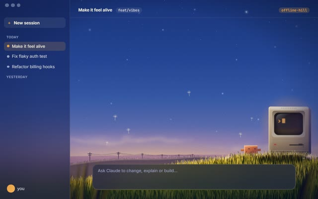</a><br>
      <b>Offline Hill</b> · dark<br>
      <code>/afterglow offline-hill</code>
    </td>
    <td width="33%" align="center" valign="top">
      <a href="https://afterglow-site-ashy.vercel.app/t/glyph-reef">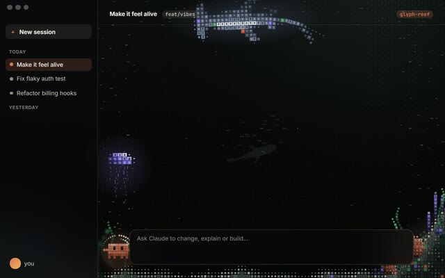</a><br>
      <b>Glyph Reef</b> · dark<br>
      <code>/afterglow glyph-reef</code>
    </td>
  </tr>
  <tr>
    <td width="33%" align="center" valign="top">
      <a href="https://afterglow-site-ashy.vercel.app/t/prism-foil">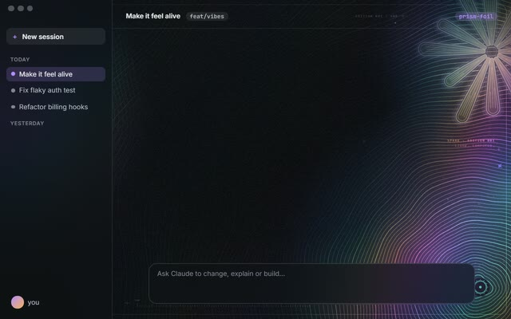</a><br>
      <b>Prism Foil</b> · dark<br>
      <code>/afterglow prism-foil</code>
    </td>
    <td width="33%" align="center" valign="top">
      <a href="https://afterglow-site-ashy.vercel.app/t/cloud-nine">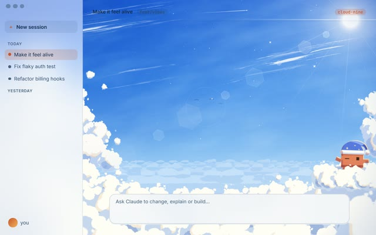</a><br>
      <b>Cloud Nine</b> · light<br>
      <code>/afterglow cloud-nine</code>
    </td>
    <td width="33%" align="center" valign="top">
      <a href="https://afterglow-site-ashy.vercel.app/t/repo-town">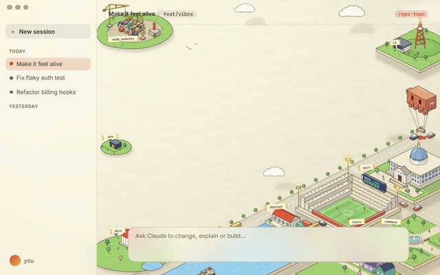</a><br>
      <b>Repo Town</b> · light<br>
      <code>/afterglow repo-town</code>
    </td>
  </tr>
  <tr>
    <td width="33%" align="center" valign="top">
      <a href="https://afterglow-site-ashy.vercel.app/t/sketch-kit">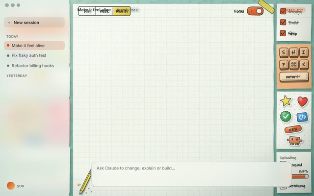</a><br>
      <b>Sketch Kit</b> · light<br>
      <code>/afterglow sketch-kit</code>
    </td>
    <td width="33%" align="center" valign="top">
      <a href="https://afterglow-site-ashy.vercel.app/t/rubber-hose">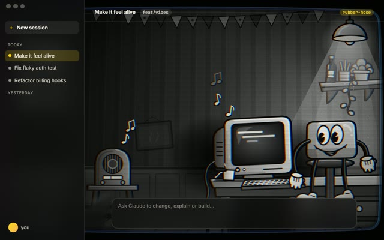</a><br>
      <b>Rubber Hose</b> · dark<br>
      <code>/afterglow rubber-hose</code>
    </td>
    <td width="33%" align="center" valign="top">
      <a href="https://afterglow-site-ashy.vercel.app/t/pocket-arcade">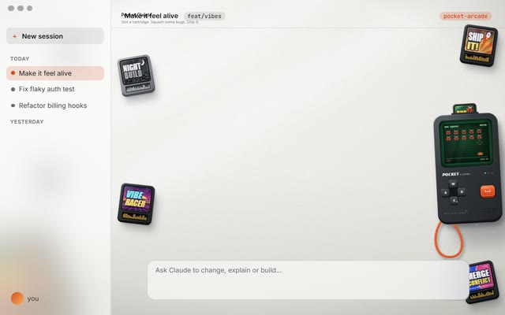</a><br>
      <b>Pocket Arcade</b> · light<br>
      <code>/afterglow pocket-arcade</code>
    </td>
  </tr>
  <tr>
    <td width="33%" align="center" valign="top">
      <a href="https://afterglow-site-ashy.vercel.app/t/gilded-pear">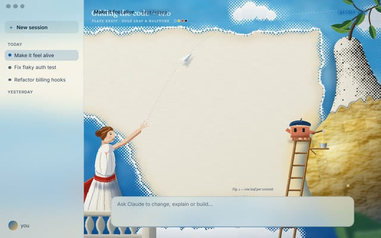</a><br>
      <b>Gilded Pear</b> · light<br>
      <code>/afterglow gilded-pear</code>
    </td>
    <td width="33%" align="center" valign="top">
      <a href="https://afterglow-site-ashy.vercel.app/t/delft-harbor">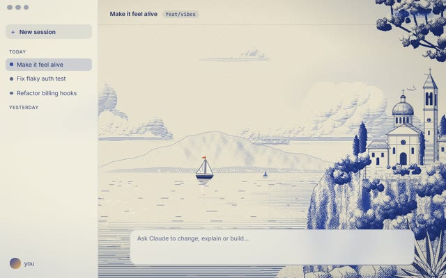</a><br>
      <b>Delft Harbor</b> · light<br>
      <code>/afterglow delft-harbor</code>
    </td>
    <td width="33%" align="center" valign="top">
      <a href="https://afterglow-site-ashy.vercel.app/t/departures">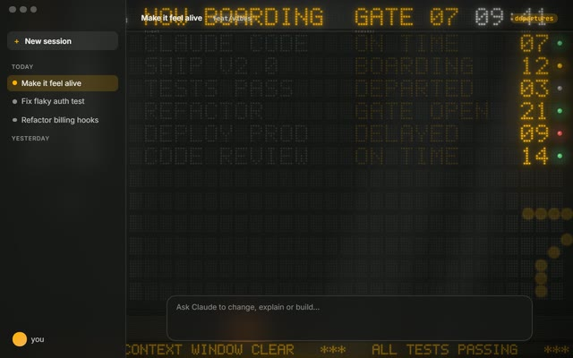</a><br>
      <b>Departures</b> · dark<br>
      <code>/afterglow departures</code>
    </td>
  </tr>
  <tr>
    <td width="33%" align="center" valign="top">
      <a href="https://afterglow-site-ashy.vercel.app/t/dithered-coast">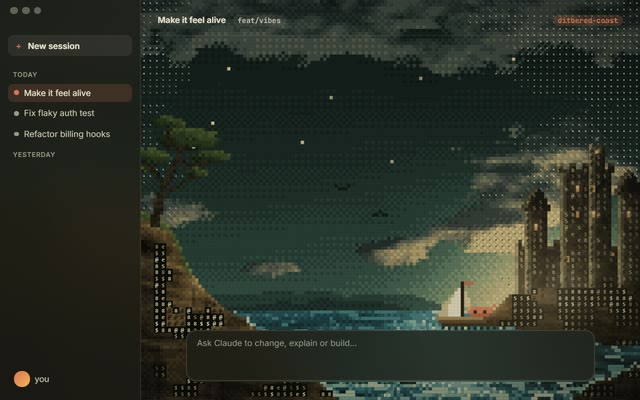</a><br>
      <b>Dithered Coast</b> · dark<br>
      <code>/afterglow dithered-coast</code>
    </td>
    <td width="33%" align="center" valign="top">
      <a href="https://afterglow-site-ashy.vercel.app/t/secret-files">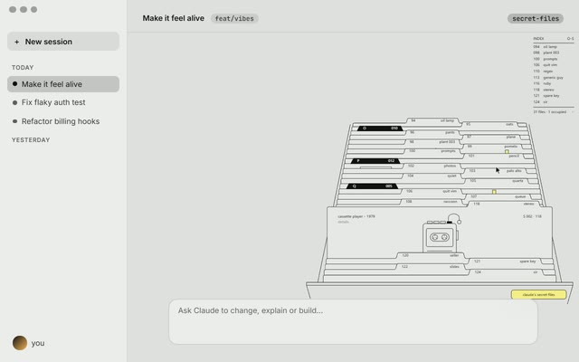</a><br>
      <b>Secret Files</b> · light<br>
      <code>/afterglow secret-files</code>
    </td>
    <td width="33%" align="center" valign="top">
      <a href="https://afterglow-site-ashy.vercel.app/t/tool-tray">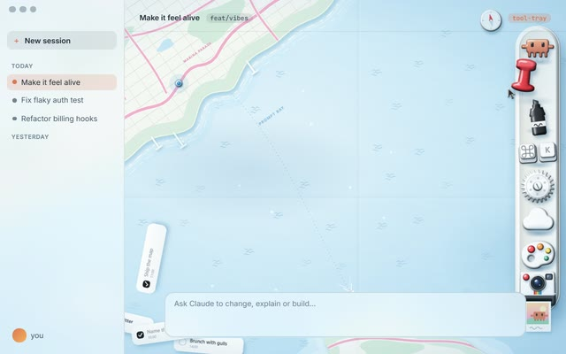</a><br>
      <b>Tool Tray</b> · light<br>
      <code>/afterglow tool-tray</code>
    </td>
  </tr>
  <tr>
    <td width="33%" align="center" valign="top">
      <a href="https://afterglow-site-ashy.vercel.app/t/voice-aurora">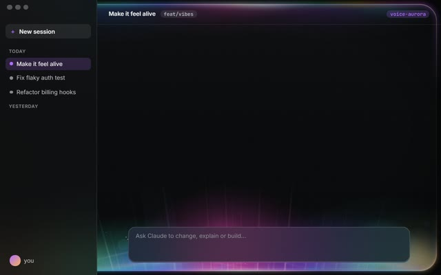</a><br>
      <b>Voice Aurora</b> · dark<br>
      <code>/afterglow voice-aurora</code>
    </td>
    <td width="33%"></td>
    <td width="33%"></td>
  </tr>
</table>

## In motion

The stills only tell half of it: every scene keeps quietly moving behind your chat.

<table>
  <tr>
    <td width="25%" align="center"><a href="https://afterglow-site-ashy.vercel.app/t/rubber-hose">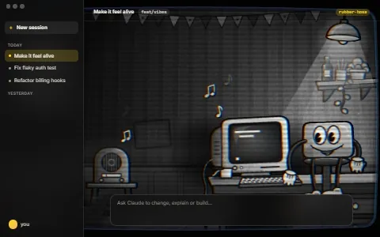</a><br><sub><b>Rubber Hose</b></sub></td>
    <td width="25%" align="center"><a href="https://afterglow-site-ashy.vercel.app/t/green-light">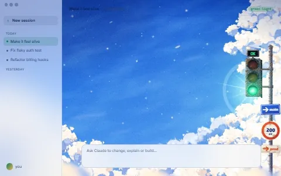</a><br><sub><b>Green Light</b></sub></td>
    <td width="25%" align="center"><a href="https://afterglow-site-ashy.vercel.app/t/departures">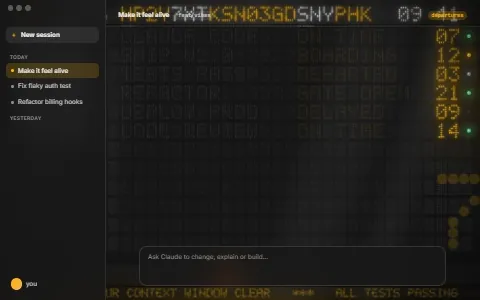</a><br><sub><b>Departures</b></sub></td>
    <td width="25%" align="center"><a href="https://afterglow-site-ashy.vercel.app/t/record-shop">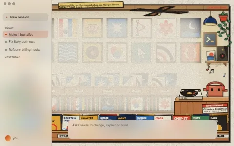</a><br><sub><b>Record Shop</b></sub></td>
  </tr>
</table>

<p align="center"><a href="https://afterglow-site-ashy.vercel.app">See all 25 running live →</a></p>

## Use

| Command | What it does |
| --- | --- |
| `/afterglow` or `/afterglow list` | Lists every theme, community ones included. |
| `/afterglow <name>` | Applies one, for example `/afterglow cloud-nine`. Your choice is remembered. |
| `/afterglow random` | Picks one at random. |
| `/afterglow refresh` | Reloads the community catalog. |
| `/afterglow off` | Clears the theme. |

Themes draw in the Claude Code desktop and mobile apps. The terminal and editors draw no backdrop, so
the command only saves your choice there.

## Try them live

Browse every theme live and try them on at
**[afterglow-site-ashy.vercel.app](https://afterglow-site-ashy.vercel.app)**.

## Network and storage

Built-in themes need no network. For community themes the mod fetches the public catalog
(`/api/catalog`, at most once an hour) and a theme you apply (`/api/themes/<name>`) from the Afterglow site,
through Claude Code's own network. It sends nothing about you. It keeps your chosen theme's name, the
catalog and up to six community themes you applied, so they work offline.

## Update

```
claude plugin marketplace update afterglow
claude plugin update afterglow@afterglow
```

## License

MIT, see [LICENSE](LICENSE).
